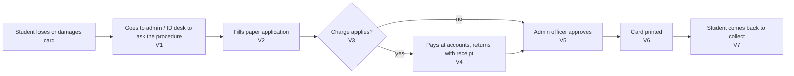

# 2. Current Process (as-is): **HYPOTHESIS, NOT YET VERIFIED**

> Everything on this page is my **expected** version of the process, written before collecting evidence. Each step has a check-ID. After I ask the ID desk and students, I mark each step as confirmed, corrected or wrong in [evidence/evidence-log.md](evidence/evidence-log.md). Until then, none of this is presented as fact.

| Step | Expected | Check-ID | How I will check |
|---|---|---|---|
| Where to apply | Admin office / ID desk | V1 | Ask the ID desk |
| Application form | Paper form; photo needed | V2 | Ask the ID desk; ask students |
| Charge | A replacement charge may apply (**amount not recorded**) | V3 | Ask yes/no only |
| Payment | Paid at accounts, separate visit | V4 | Ask students how many counters they visited |
| Approval | Admin officer signs | V5 | Ask the ID desk who approves |
| Printing | Done in-house or by a vendor; takes days | V6 | Ask the ID desk; ask students how many days |
| Collection | Student returns to collect | V7 | Ask students |
| Meanwhile | No card for library, hostel or exam entry? | V8 | Ask students what they used meanwhile |
| Police report | Is an FIR needed for a lost card? | V9 | Ask the ID desk |

**Why I expect several offices:** two other universities' published procedures need 3 and 5 separate sign-offs (NIT Calicut and Thapar, evidence E3 and E4, [evidence/benchmarks.md](evidence/benchmarks.md)). That makes H1 **plausible**, but it says nothing certain about IFHE.

## Problem I expect to find (hypothesis H1)
A student needs **several visits to different counters** (desk → accounts → desk → collect) and **cannot see the status**, so they come back to ask "is it ready?". Meanwhile they have no ID for the library, hostel or exams.

**H1 is accepted only if** at least 3 of the students I ask report 2 or more visits, or the ID desk confirms more than one counter is involved. If not, I will report that the process already works well, which is also a valid finding.

## Scale (to be measured)
Monthly requests, visits per request and days to receive the card are **unknown**. The calculation in [time-saving.md](time-saving.md) uses clearly marked illustrative values until I measure them.
