# 3. Proposed Process (to-be) [design]

**Idea:** one request, submitted online, that **carries its own status**. Payment and approval are checked at one desk instead of the student walking between counters, and the student is told when the card is ready. Every rule below is built and tested in [prototype/idcard_workflow.py](prototype/idcard_workflow.py).

```mermaid
stateDiagram-v2
    [*] --> SUBMITTED: student submits own request
    SUBMITTED --> NEEDS_INFO: photo / declaration / charge missing
    NEEDS_INFO --> SUBMITTED: student adds it
    SUBMITTED --> VERIFIED: ID desk checks details
    VERIFIED --> APPROVED: admin officer (within boundary)
    VERIFIED --> ESCALATED: 3rd+ replacement in 12 months
    ESCALATED --> APPROVED: admin head
    APPROVED --> READY: card printed
    APPROVED --> PRINT_FAILED: printer fails, temporary pass given
    PRINT_FAILED --> READY: reprint, or manual card after 2nd failure
    READY --> COLLECTED: only the student collects; old card deactivated
    SUBMITTED --> REJECTED: duplicate of an open request
    COLLECTED --> [*]
```

| Element | Design |
|---|---|
| **Inputs** | Student reference (from login, not typed by hand), reason (lost / damaged / details change), photo attached, declaration signed, charge cleared (yes/no). **Proof depends on the reason:** old card handed in if damaged or details change; FIR copy if lost, **only if IFHE requires it** (V9; a setting in the code) |
| **Statuses** | SUBMITTED, NEEDS_INFO, VERIFIED, ESCALATED, APPROVED, PRINT_FAILED, READY, COLLECTED, REJECTED |
| **Accountable owner** | Admin officer in charge of ID cards: one role owns every request until COLLECTED |
| **Roles** | Student (submit, add info, collect own card) · ID desk (verify, print, hand over) · Admin officer (approve) · Admin head (escalated cases only) |
| **Approval boundary** *(illustrative, to confirm as V5)* | Admin officer approves a student's 1st and 2nd replacement in 12 months. The 3rd or later goes to the admin head, which discourages misuse |
| **Controls** | A student can only request and collect **their own** card. Staff can only do their own step. Every blocked attempt goes to a security log |
| **Fallback** | Printer/system fails → **temporary pass** at once and a reprint. Fails again → manual card. Online form down → paper form with the same fields, entered later |

**Design choices based on other universities** ([evidence/benchmarks.md](evidence/benchmarks.md)): the temporary pass (NIT Calicut issues a paper card first), the repeat-replacement boundary (NIT Calicut asks how many duplicates were issued before), proof by reason and suspending the old card (Thapar).

## Why this should help (if H1 is confirmed)
- **Fewer visits:** problems like a missing photo are caught online (NEEDS_INFO), not at the counter.
- **No "is it ready?" visits:** the status is visible.
- **No gap without ID:** the temporary pass covers failures.

## What it does not fix
- If printing itself takes days (V6), this design does not make the printer faster.
- It needs a student login, which a plain Google Form does not have. The prototype assumes login-based identity.
